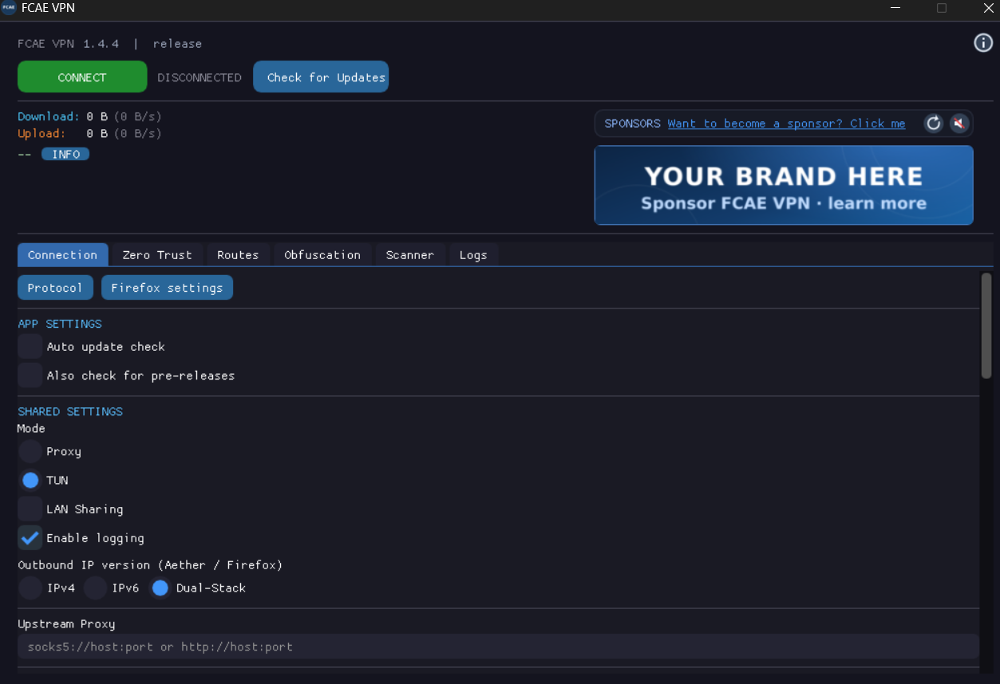
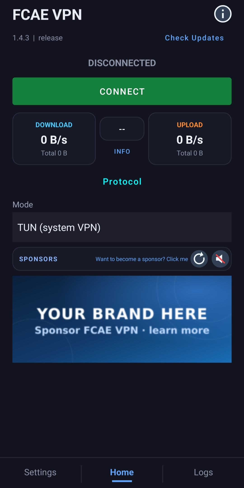

# FCAE VPN

<p align="center">
  
</p>

<p align="center">
  <a href="https://github.com/FCFlenkchy/FCAE_VPN/releases">
    
  </a>
</p>

A censorship circumvention client for Windows, Linux, macOS, and Android, with TUN and local proxy modes.

## Available cores

- **Aether (WARP)** — Cloudflare WARP support, including Tor routing.
- **Firefox IP Protection** — Rust-based support for Mozilla's Firefox IP Protection service.
- **Psiphon** — Psiphon tunnel core.
- **Xray-core** — VLESS, VMess, Trojan, Shadowsocks, SOCKS5 and HTTP outbounds (TLS, REALITY, WS, gRPC, HTTP/2, HTTPUpgrade). Built from source into the same Go archive as tun2socks and Psiphon, and started in-process; set `FcaeConfig.core.profile` to a share link or a native config.
- **sing-box** — the same outbounds, served by sing-box's own config dialect, built with its complete upstream feature set (every protocol, transport, endpoint and service an official binary carries: WireGuard, QUIC/Hysteria2/TUIC, gVisor, OpenVPN, OpenConnect, Tailscale, ACME, Cloudflared, Clash API). Its own generator, in that same archive; the UI treats both identically. FCAE owns the TUN device, so a native config's `tun` inbound is served by it: the inbound becomes the session's SOCKS listener, under its own tag, so the config's route rules still match what they were written for.

## Inline Routing Rules (Aether only)

Aether supports custom routing rules directly in the UI (Routes tab) without needing an external file. These rules apply only to Aether. Rules use a simple format:

```
[direct]ip:190.9.2.4,192.33.45.6:400,example.com
[block]gazo.com,10.0.0.0/8,keyword:ads
```

**Format:**
- `[direct]` — traffic matching these rules bypasses the VPN (direct connection)
- `[block]` — traffic matching these rules is blocked entirely
- Entries are comma or newline separated
- Unprefixed entries default to `[direct]`

**Supported rule types:**
| Type | Example | Description |
|------|---------|-------------|
| Bare domain | `example.com` | Matches domain and all subdomains |
| Full domain | `full:example.com` | Exact domain match only |
| Keyword | `keyword:ads` | Matches if domain contains keyword |
| Regex | `regexp:^ad[0-9]+\.` | Regex pattern match |
| IP / CIDR | `10.0.0.0/8`, `1.2.3.4` | IP address or CIDR range |
| Port | `port:25`, `port:3000-3010` | Port or port range |
| Private | `private` | All LAN/private IPs |
| IP with port | `192.33.45.6:400` | IP address with specific port |

## Platforms

| Platform | Backend | UI |
|----------|---------|----|
| Windows | DirectX 11 | ImGui |
| Linux | GLFW + OpenGL | ImGui |
| macOS | GLFW + OpenGL | ImGui |
| Android | Kotlin Material VpnService + JNI bridge | Kotlin Material UI |

### Screenshots

<p align="center">
  
  &nbsp;
  
</p>

## Building

### Requirements

- Rust (latest stable)
- C/C++ compiler (GCC/Clang/MSVC)
- CMake >= 3.22
- Vulkan SDK or DirectX SDK (Windows)
- For Android: NDK, Android SDK, Kotlin

### Build the Rust engine first

```bash
cargo build --manifest-path core/Cargo.toml -p aether-ffi --release
```

### Build the native GUI

```bash
cmake -B build -DAETHER_TARGET=LINUX_X64
cmake --build build --config Release
```

Targets: `LINUX_X64`, `WIN_X64`, `MACOS_ARM64`, `MACOS_X64`, `ANDROID_ARM64`.

### Android

Open `android/` in Android Studio and build. The Gradle config invokes CMake with `ANDROID_ARM64` automatically.

## Credits

- **Firefox IP Protection** — Implemented in Rust. See the [Firefox IP Protection source code](https://searchfox.org/firefox-main/source/toolkit/components/ipprotection/) (used [Arman VPN](https://github.com/armanlife/arman-vpn-client) and [FoxyVPN](https://github.com/Vauth/FoxyVPN) as references).
- **[Aether](https://github.com/CluvexStudio/aether)** — The core censorship circumvention engine by CluvexStudio. Provides MASQUE, WireGuard, WARP-in-WARP and WARP-in-MASQUE protocols.
- **[Dear ImGui](https://github.com/ocornut/imgui)** — Immediate-mode GUI library Used for all native desktop rendering.
- **[hev-socks5-tunnel](https://github.com/heiher/hev-socks5-tunnel)** — C SOCKS5 tunnel engine, runs in-process.
- **[Psiphon](https://github.com/Psiphon-Labs/psiphon-tunnel-core)** — Psiphon tunnel core library.
- **[Xray-core](https://github.com/XTLS/Xray-core)** — Proxy core, compiled into the app's Go archive and run in-process.
- **[sing-box](https://github.com/SagerNet/sing-box)** — Proxy core, compiled into the same Go archive and run in-process.
- **[qpack](https://github.com/quic-go/qpack)** — QPACK header compression behind the quic-go forks in that archive. Psiphon's fork predates qpack 0.6's API while sing-box's and Xray-core's require it, so `core/fcae-ffi/gomods/qpack` carries one version with both, instead of pinning one the other half cannot build against.
- **[Quiche](https://github.com/cloudflare/quiche)** — Cloudflare's HTTP/3 and QUIC implementation. Used as the QUIC transport backend for MASQUE protocol support.
- **[Wintun](https://www.wintun.net/)** — A TUN driver for Windows by WireGuard. Provides a high-performance network interface at Layer 3 for tunneling traffic.
- **[tun2socks](https://github.com/xjasonlyu/tun2socks)** — A Go library that transparently routes TUN device traffic through a SOCKS5 proxy. Powers the system-wide VPN TUN mode across all supported platforms (Linux, Windows, macOS, and Android).
- **[zeptun](https://github.com/Noisemux/zeptun)** — A Zig TUN engine, statically linked and running in-process. Provides an alternative to tun2socks on Linux, macOS, and Android.

## Community

Join the official Telegram channel for release announcements, connectivity notices, and configuration tips — plus answers from the maintainers and other users:

<p align="center">
  <a href="https://t.me/FCAE_VPN">
    
  </a>
</p>

- **Release announcements** — new versions, changelogs, and platform-specific notes.
- **Connectivity notices** — early warnings when endpoints are blocked or a route needs updating.
- **Support and tips** — setup help, troubleshooting, and answers from the community.

Bug reports and feature requests belong in **[GitHub Issues](https://github.com/FCFlenkchy/FCAE_VPN/issues)** so they stay tracked and searchable — the channel is for everything else.

## Support development

If you'd like to support the developer, you can send GRAM (The Open Network) to:

`UQAz9mcfJ5qlba97SPbrCw-Yt8OhhT58yG9PzARyu1Muz0jV`

Use The Open Network only. Donations are optional.

## Sponsorship

Interested in sponsoring FCAE? Read the **[Sponsor Policy](SPONSOR_POLICY.md)** for eligibility, content requirements, privacy rules, and contact information.

## Contributing

Contributions are welcome! Whether it's bug reports, feature requests, documentation improvements, or code contributions — feel free to open an issue or pull request.

### How to Contribute

For questions and general discussion, see the [Community](#community) section.

1. Fork the repository
2. Create a feature branch (`git checkout -b feature/amazing-feature`)
3. Commit your changes (`git commit -m 'Add amazing feature'`)
4. Push to the branch (`git push origin feature/amazing-feature`)
5. Open a Pull Request

## License

Released under the [LICENSE](LICENSE)

The names FCAE and FCAE VPN are trademarks of this project. See [TRADEMARK](TRADEMARK).

---

<div align="center">

### Found this useful?

If this project helped you bypass censorship or just saved you some time, consider giving it a **star** — it helps others discover the tool and motivates continued development.

[](https://github.com/FCFlenkchy/FCAE_VPN)

**Other languages:** [فارسی](READMEFA.md) | [中文](READMECH.md)

</div>
