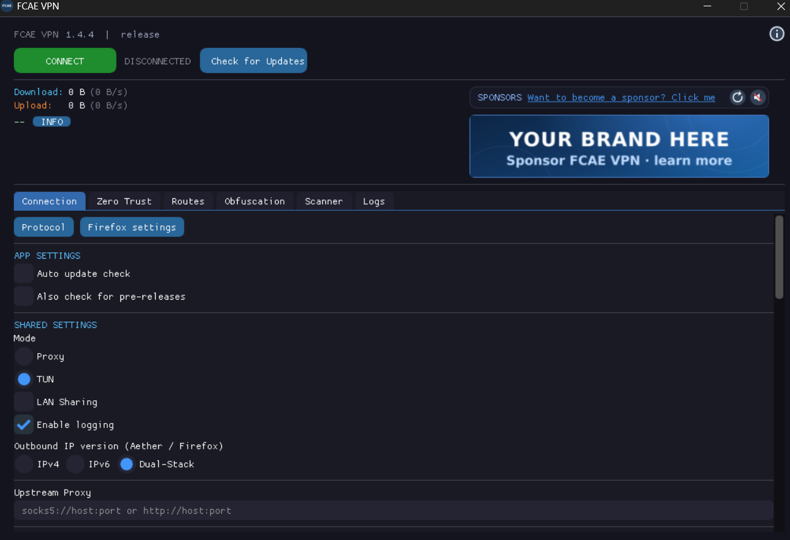
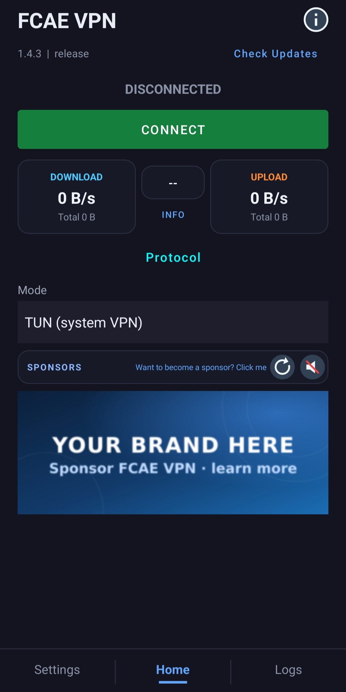

# FCAE VPN

<p align="center">
  
</p>

<p align="center">
  <a href="https://github.com/FCFlenkchy/FCAE_VPN/releases">
    
  </a>
</p>

**[English](README.md)** | **[فارسی](READMEFA.md)** | **中文**

FCAE VPN 是一款适用于 Windows、Linux、macOS 和 Android 的审查绕过客户端，支持 TUN 和本地代理模式。

## 可用核心

- **Aether (WARP)** — 支持 Cloudflare WARP，包括 Tor 路由。
- **Firefox IP Protection** — 使用 Rust 实现对 Mozilla Firefox IP Protection 服务的支持。
- **Psiphon** — Psiphon 隧道核心。

## 功能特性

- 支持 MASQUE (HTTP/3 QUIC / HTTP/2)、WireGuard、WARP-in-WARP (gool) 和 WARP-in-MASQUE
- 可配置的流量混淆配置文件
- 自动重连，支持快速重连
- 本地 SOCKS5 和 HTTP 代理
- 所有平台原生 GUI（桌面端 ImGui + DirectX11/OpenGL，Android 端 Kotlin Material UI）

## 内联路由规则

您可以直接在 UI（Routes 选项卡）中定义自定义路由规则，无需外部文件。规则使用简单格式：

```
[direct]ip:190.9.2.4,192.33.45.6:400,example.com
[block]gazo.com,10.0.0.0/8,keyword:ads
```

**格式说明：**
- `[direct]` — 匹配的流量绕过 VPN（直连）
- `[block]` — 匹配的流量完全阻止
- 条目可用逗号或换行分隔
- 无前缀条目默认为 `[direct]`

**支持的规则类型：**
| 类型 | 示例 | 说明 |
|------|---------|-------------|
| 普通域名 | `example.com` | 匹配域名及所有子域名 |
| 完整域名 | `full:example.com` | 仅精确匹配域名 |
| 关键词 | `keyword:ads` | 域名包含关键词即匹配 |
| 正则表达式 | `regexp:^ad[0-9]+\.` | 正则模式匹配 |
| IP / CIDR | `10.0.0.0/8`, `1.2.3.4` | IP 地址或 CIDR 范围 |
| 端口 | `port:25`, `port:3000-3010` | 端口或端口范围 |
| 私有地址 | `private` | 所有局域网/私有 IP |
| IP 带端口 | `192.33.45.6:400` | 带指定端口的 IP 地址 |

**桌面端：** 打开 **Routes** 选项卡，将规则粘贴到 "Inline Routing Rules" 文本框中。

**Android 端：** 滚动到 "Inline routing rules" 并输入您的规则。点击 **CONNECT** 应用。

通过内联输入设置的规则优先级更高，并与 "Routing Rules File" 字段中指定的任何规则文件合并。

## 支持平台

| 平台 | 后端 | UI |
|----------|---------|----|
| Windows | DirectX 11 | ImGui |
| Linux | GLFW + OpenGL | ImGui |
| macOS | GLFW + OpenGL | ImGui |
| Android | Kotlin Material VpnService + JNI 桥接 | Kotlin Material UI |

### 界面截图

<p align="center">
  
  &nbsp;
  
</p>

## 构建

### 依赖要求

- Rust（最新稳定版）
- C/C++ 编译器（GCC/Clang/MSVC）
- CMake >= 3.22
- Vulkan SDK 或 DirectX SDK（Windows）
- Android 构建需要：NDK、Android SDK、Kotlin

### 首先构建 Rust 引擎

```bash
cargo build --manifest-path core/Cargo.toml -p aether-ffi --release
```

### 构建原生 GUI

```bash
cmake -B build -DAETHER_TARGET=LINUX_X64
cmake --build build --config Release
```

目标平台：`LINUX_X64`、`WIN_X64`、`MACOS_ARM64`、`MACOS_X64`、`ANDROID_ARM64`。

### Android

在 Android Studio 中打开 `android/` 目录并构建。Gradle 配置会自动使用 `ANDROID_ARM64` 调用 CMake。

## 致谢

- **Firefox IP Protection** — 使用 Rust 实现，并参考了 [FoxyVPN](https://github.com/Vauth/FoxyVPN) 和 [Arman VPN](https://github.com/armanlife/arman-vpn-client)。感谢这两个项目。
- **[Aether](https://github.com/CluvexStudio/aether)** — 由 CluvexStudio 开发的核心审查绕过引擎。提供 MASQUE、WireGuard、WARP-in-WARP 和 WARP-in-MASQUE 协议。
- **[Dear ImGui](https://github.com/ocornut/imgui)** — 即时模式 GUI 库，用于所有原生桌面渲染。
- **[hev-socks5-tunnel](https://github.com/heiher/hev-socks5-tunnel)** — C 语言 SOCKS5 隧道引擎，进程内运行。
- **[Psiphon](https://github.com/Psiphon-Labs/psiphon-tunnel-core)** — Psiphon 隧道核心库。
- **[Quiche](https://github.com/cloudflare/quiche)** — Cloudflare 的 HTTP/3 和 QUIC 实现。作为 MASQUE 协议支持的 QUIC 传输后端。
- **[Wintun](https://www.wintun.net/)** — 由 WireGuard 开发的 Windows TUN 驱动程序。提供高性能的第 3 层网络接口，用于隧道传输流量。
- **[tun2socks](https://github.com/xjasonlyu/tun2socks)** — 一个 Go 库，可透明地将 TUN 设备流量通过 SOCKS5 代理路由。为所有支持的平台（Linux、Windows、macOS 和 Android）上的系统级 VPN TUN 模式提供支持。
- **[zeptun](https://github.com/Noisemux/zeptun)** — 使用 Zig 编写的 TUN 引擎，通过静态链接在应用进程内运行。在 Linux、macOS 和 Android 上提供 tun2socks 之外的另一种选择。

## Telegram 频道

欢迎加入我们的官方 Telegram 频道，第一时间获取版本发布、连接状态与配置技巧，并与开发者和其他用户交流：

<p align="center">
  <a href="https://t.me/FCAE_VPN">
    
  </a>
</p>

- **版本发布** — 新版本发布、更新日志以及各平台的注意事项。
- **连接状态** — 端点被封锁或线路变更时的及时通知。
- **支持与交流** — 配置帮助、故障排查，以及来自开发者和其他用户的解答。

Bug 反馈与功能建议请提交到 **[GitHub Issues](https://github.com/FCFlenkchy/FCAE_VPN/issues)**，以便跟踪与检索；Telegram 频道适合日常交流与提问。

## 支持开发

如果您愿意支持开发者，可以通过 GRAM（The Open Network）向以下地址捐赠：

`UQAz9mcfJ5qlba97SPbrCw-Yt8OhhT58yG9PzARyu1Muz0jV`

请仅使用 The Open Network 网络。捐赠完全自愿。

## 成为赞助商

有意赞助 FCAE？请阅读 **[赞助政策](SPONSOR_POLICY.md)**，了解资格要求、内容规范、隐私规则和联系方式。

## 贡献

欢迎贡献！无论是错误报告、功能请求、文档改进还是代码贡献 — 都可以提交 Issue 或 Pull Request。

### 如何贡献

日常提问与交流请参阅本页的「Telegram 频道」部分。

1. Fork 本仓库
2. 创建功能分支 (`git checkout -b feature/amazing-feature`)
3. 提交更改 (`git commit -m 'Add amazing feature'`)
4. 推送到分支 (`git push origin feature/amazing-feature`)
5. 创建 Pull Request

## 许可证

根据 [LICENSE](LICENSE) 发布。

FCAE 与 FCAE VPN 为本项目商标。见 [TRADEMARK](TRADEMARK)。

---

<div align="center">

### 觉得有用？

如果这个项目帮助您绕过了审查，或者为您节省了时间，请考虑给一个 **Star** — 这能帮助更多人发现这个工具，也是持续开发的动力。

[](https://github.com/FCFlenkchy/FCAE_VPN)

**其他语言：** [English](README.md) | [فارسی](READMEFA.md)

</div>