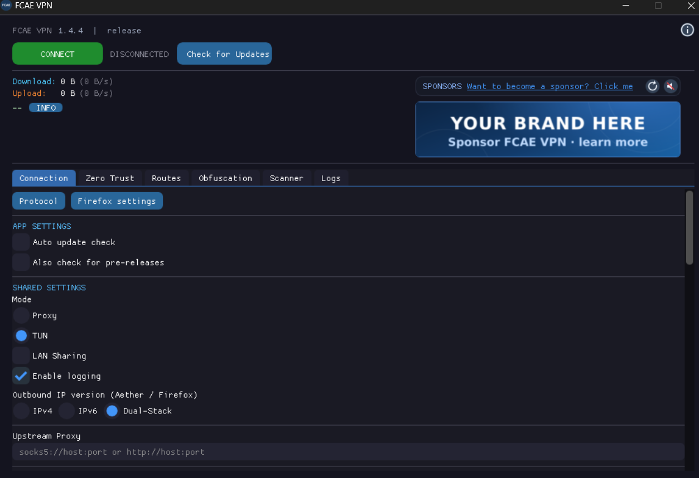
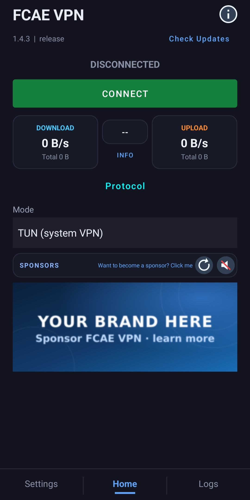

# FCAE VPN

<p align="center">
  
</p>

<p align="center">
  <a href="https://github.com/FCFlenkchy/FCAE_VPN/releases">
    
  </a>
</p>

**[English](README.md)** | **فارسی** | **[中文](READMECH.md)**

FCAE VPN یک ابزار دور زدن سانسور برای ویندوز، لینوکس، مک و اندروید است و از حالت‌های TUN و پروکسی محلی پشتیبانی می‌کند.

## هسته‌های موجود

- **Aether (WARP)** — پشتیبانی از Cloudflare WARP، شامل مسیریابی Tor.
- **Firefox IP Protection** — پشتیبانی از سرویس Firefox IP Protection موزیلا با پیاده‌سازی Rust.
- **Psiphon** — هسته تونل سایفون.

## قوانین مسیریابی درون‌خطی (فقط Aether)

قوانین مسیریابی سفارشی را می‌توانید بدون فایل خارجی در رابط کاربری وارد کنید. این قوانین فقط برای Aether اعمال می‌شوند و فرمت ساده‌ای دارند:

```
[direct]ip:190.9.2.4,192.33.45.6:400,example.com
[block]gazo.com,10.0.0.0/8,keyword:ads
```

**فرمت:**
- `[direct]` — ترافیک منطبق با این قوانین از VPN عبور نمی‌کند (اتصال مستقیم)
- `[block]` — ترافیک منطبق با این قوانین کاملاً مسدود می‌شود
- ورودی‌ها با کاما یا خط جدید جدا می‌شوند
- ورودی‌های بدون پیشوند به‌طور پیش‌فرض `[direct]` در نظر گرفته می‌شوند

**انواع قوانین پشتیبانی‌شده:**
| نوع | مثال | توضیحات |
|------|---------|-------------|
| دامنه ساده | `example.com` | تطبیق دامنه و تمام زیردامنه‌ها |
| دامنه کامل | `full:example.com` | فقط تطبیق دقیق دامنه |
| کلمه کلیدی | `keyword:ads` | تطبیق اگر دامنه حاوی کلمه کلیدی باشد |
| عبارت منظم | `regexp:^ad[0-9]+\.` | تطبیق الگوی regex |
| IP / CIDR | `10.0.0.0/8`, `1.2.3.4` | آدرس IP یا محدوده CIDR |
| پورت | `port:25`, `port:3000-3010` | پورت یا محدوده پورت |
| خصوصی | `private` | تمام IPهای خصوصی/LAN |
| IP با پورت | `192.33.45.6:400` | آدرس IP با پورت مشخص |

## پلتفرم‌ها

| پلتفرم | بک‌اند | رابط کاربری |
|----------|---------|----|
| ویندوز | DirectX 11 | ImGui |
| لینوکس | GLFW + OpenGL | ImGui |
| مک | GLFW + OpenGL | ImGui |
| اندروید | Kotlin Material VpnService + پل JNI | Kotlin Material UI |

### تصاویر

<p align="center">
  
  &nbsp;
  
</p>

## ساخت

### پیش‌نیازها

- Rust (آخرین نسخه پایدار)
- کامپایلر C/C++ (GCC/Clang/MSVC)
- CMake >= 3.22
- Vulkan SDK یا DirectX SDK (ویندوز)
- برای اندروید: NDK، Android SDK، Kotlin

### ابتدا موتور Rust را بسازید

```bash
cargo build --manifest-path core/Cargo.toml -p aether-ffi --release
```

### ساخت رابط گرافیکی بومی

```bash
cmake -B build -DAETHER_TARGET=LINUX_X64
cmake --build build --config Release
```

 Targets: `LINUX_X64`, `WIN_X64`, `MACOS_ARM64`, `MACOS_X64`, `ANDROID_ARM64`.

### اندروید

پوشه `android/` را در Android Studio باز کنید و بسازید. تنظیمات Gradle به‌طور خودکار CMake را با `ANDROID_ARM64` فراخوانی می‌کند.

## قدردانی

- **Firefox IP Protection** — پیاده‌سازی‌شده با Rust با استفاده از [FoxyVPN](https://github.com/Vauth/FoxyVPN) و [Arman VPN](https://github.com/armanlife/arman-vpn-client) به‌عنوان منابع مرجع. از هر دو پروژه سپاسگزاریم.
- **[Aether](https://github.com/CluvexStudio/aether)** — موتور اصلی دور زدن سانسور توسط CluvexStudio. پروتکل‌های MASQUE، WireGuard، WARP-in-WARP و WARP-in-MASQUE را فراهم می‌کند.
- **[Dear ImGui](https://github.com/ocornut/imgui)** — کتابخانه رابط گرافیکی حالت فوری. برای تمام رندرهای بومی دسکتاپ استفاده می‌شود.
- **[hev-socks5-tunnel](https://github.com/heiher/hev-socks5-tunnel)** — موتور تونل SOCKS5 به زبان C، داخل فرایند اجرا می‌شود.
- **[Psiphon](https://github.com/Psiphon-Labs/psiphon-tunnel-core)** — کتابخانه هسته تونل سایفون.
- **[Quiche](https://github.com/cloudflare/quiche)** — پیاده‌سازی HTTP/3 و QUIC کلادفلر. به‌عنوان بک‌اند حمل‌ونقل QUIC برای پشتیبانی از پروتکل MASQUE استفاده می‌شود.
- **[Wintun](https://www.wintun.net/)** — یک درایور TUN برای ویندوز ساخته‌شده توسط WireGuard. یک رابط شبکه با کارایی بالا در لایه ۳ برای تونل کردن ترافیک فراهم می‌کند.
- **[tun2socks](https://github.com/xjasonlyu/tun2socks)** — یک کتابخانه Go که ترافیک دستگاه TUN را به‌صورت شفاف از طریق پروکسی SOCKS5 مسیریابی می‌کند. قدرت‌دهنده حالت TUN VPN در سطح سیستم در تمام پلتفرم‌های پشتیبانی‌شده (لینوکس، ویندوز، مک و اندروید).
- **[zeptun](https://github.com/Noisemux/zeptun)** — موتور TUN نوشته‌شده با Zig که به‌صورت ایستا پیوند داده می‌شود و داخل فرایند برنامه اجرا می‌شود. گزینه‌ای جایگزین برای tun2socks در لینوکس، مک و اندروید فراهم می‌کند.

## کانال تلگرام

برای اطلاع از انتشار نسخه‌های جدید، وضعیت اتصال و نکات پیکربندی — و همچنین دریافت پشتیبانی و پاسخ پرسش‌ها — به کانال رسمی ما در تلگرام بپیوندید:

<p align="center">
  <a href="https://t.me/FCAE_VPN">
    
  </a>
</p>

- **اطلاعیه نسخه‌ها** — انتشار نسخه‌های جدید، فهرست تغییرات و نکات مربوط به هر پلتفرم.
- **وضعیت اتصال** — اطلاع‌رسانی زودهنگام درباره مسدود شدن نقاط اتصال و تغییر مسیرها.
- **پشتیبانی و راهنمایی** — کمک در راه‌اندازی و رفع اشکال، از سوی توسعه‌دهنده و سایر کاربران.

برای گزارش باگ و درخواست ویژگی از **[GitHub Issues](https://github.com/FCFlenkchy/FCAE_VPN/issues)** استفاده کنید تا پیگیری و جست‌وجو ساده بماند؛ کانال تلگرام برای گفتگو، پرسش و اطلاع‌رسانی است.

## حمایت از توسعه

اگر مایلید از توسعه‌دهنده حمایت کنید، می‌توانید در شبکه GRAM (The Open Network) به این نشانی کمک کنید:

`UQAz9mcfJ5qlba97SPbrCw-Yt8OhhT58yG9PzARyu1Muz0jV`

فقط از شبکه The Open Network استفاده کنید. کمک مالی کاملاً اختیاری است.

## اسپانسر شدن

مایلید اسپانسر FCAE شوید؟ برای اطلاع از شرایط پذیرش، الزامات محتوا، قوانین حریم خصوصی و راه ارتباطی، **[سیاست اسپانسرها](SPONSOR_POLICY.md)** را مطالعه کنید.

## مشارکت

مشارکت‌ها خوش‌آمد هستند! چه گزارش باگ، درخواست ویژگی، بهبود مستندات یا مشارکت کد — می‌توانید یک Issue یا Pull Request باز کنید.

### نحوه مشارکت

برای پرسش‌ها و گفتگوی عمومی به بخش «کانال تلگرام» در همین صفحه مراجعه کنید.

1. مخزن را Fork کنید
2. یک شاخه ویژگی بسازید (`git checkout -b feature/amazing-feature`)
3. تغییرات خود را Commit کنید (`git commit -m 'Add amazing feature'`)
4. به شاخه Push کنید (`git push origin feature/amazing-feature`)
5. یک Pull Request باز کنید

## مجوز

تحت [LICENSE](LICENSE) منتشر شده است.

نام‌های FCAE و FCAE VPN علامت تجاری این پروژه هستند. بنگرید به [TRADEMARK](TRADEMARK).

---

<div align="center">

### آیا این پروژه برایتان مفید بود؟

اگر این پروژه به شما در دور زدن سانسور کمک کرد یا وقتتان را ذخیره کرد، لطفاً یک **ستاره** بدهید، این کار به دیگران کمک می‌کند ابزار را پیدا کنند و انگیزه‌ای برای ادامه توسعه است...

[](https://github.com/FCFlenkchy/FCAE_VPN)

**زبان‌های دیگر:** [English](README.md) | [中文](READMECH.md)

</div>
